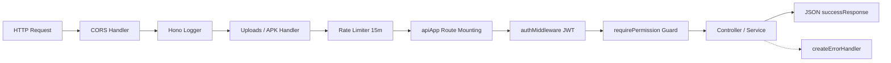

# 🏗️ Arsitektur Backend & Konfigurasi Server — mshipping

Dokumentasi arsitektur runtime, framework, middleware pipeline, database layer, dan konfigurasi server backend mshipping.

---

## 1. ⚙️ Teknologi & Runtime

- **Runtime Engine**: [Bun](https://bun.sh/) (v1.3+) — eksekusi TypeScript native berkecepatan tinggi tanpa transpiler eksternal.
- **Web Framework**: [Hono.js](https://hono.dev/) (v4+) — ultra-fast, lightweight web framework dengan routing berbasis RegExp trie.
- **ORM & Database Client**: [Prisma ORM](https://www.prisma.io/) (v6+) dikonfigurasi untuk Microsoft SQL Server (`sqlserver`).
- **Database Server**: Microsoft SQL Server (MS SQL Server) pada jaringan internal / host `SEJDB`.
- **Process Manager**: PM2 runtime process dengan nama service **`ShippingApi`**.
- **Port & Binding**: Port `3010`, listening pada `0.0.0.0` (support local dev & reverse proxy Nginx IIS).
- **Socket Idle Timeout**: `120` detik (`Bun.serve({ idleTimeout: 120 })`) untuk mencegah pemutusan koneksi prematur pada kueri agregasi panjang.

---

## 2. 🛡️ Middleware Pipeline

Setiap HTTP request yang masuk ke backend melewati urutan middleware berikut (`src/index.ts`):



### 1. CORS (`hono/cors`)
- Origin: `'http://36.93.22.142'` (Production) atau `'*'` (Development).
- Allowed Methods: `GET`, `POST`, `PUT`, `DELETE`, `PATCH`, `OPTIONS`.
- Allowed Headers: `Content-Type`, `Authorization`.

### 2. Rate Limiter (`hono-rate-limiter`)
- Window: 15 Menit (`15 * 60 * 1000`).
- Limit: 1.000 requests (Production) / 10.000 requests (Development).
- Key Generator: `x-forwarded-for` $\to$ `x-real-ip` $\to$ `'local-dev'`.
- Login Rate Limiter khusus: Max 5 percobaan / 15 menit di Production.

### 3. Error Handler Terpusat (`src/middleware/errorHandler.ts`)
- Menangkap unhandled exception, galat Prisma (`P1001`, `P1002`, `P2002`), Zod validation error, dan HTTP exception.
- Mengembalikan response JSON terstandarisasi dengan kode status yang sesuai (`400`, `401`, `403`, `404`, `429`, `500`).

---

## 3. 📂 Struktur Folder Backend (`backend/src/`)

```text
backend/src/
├── config/                  # Konfigurasi runtime & database
│   ├── database.ts          # Singleton PrismaClient instance
│   ├── env.ts               # Environment variables (Zod validated)
│   └── logger.ts            # Winston logger terpusat
├── middleware/              # Global & route middlewares
│   ├── auth.ts              # JWT verify, requirePermission, isAdmin
│   └── errorHandler.ts      # Global exception & Prisma error handler
├── modules/                 # 18 Domain Modul Bisnis
│   ├── <domain>/
│   │   ├── <domain>.routes.ts    # Hono sub-app router & HTTP endpoints
│   │   ├── <domain>.service.ts   # Logika bisnis, query Prisma, & transaksi SQL
│   │   ├── <domain>.schema.ts    # Zod validation schema (input payload)
│   │   └── <domain>.types.ts     # TypeScript interfaces & DTOs
├── utils/                   # Utilitas terpusat
│   ├── cache.ts             # In-memory LRU/FIFO suggestion cache (TTL 30s)
│   ├── pagination.ts        # Helper pagination buildPagination & parsePagination
│   └── response.ts          # successResponse & errorResponse builders
└── index.ts                 # Entry point server Bun.serve & route registration
```

---

## 4. 🗄️ Database Singleton & Resiliensi Kueri (`safeQuery`)

### Prisma Singleton (`src/config/database.ts`)
```ts
import { PrismaClient } from '@prisma/client'
// DILARANG new PrismaClient() di setiap service! Selalu import singleton ini:
export const prisma = globalForPrisma.prisma || new PrismaClient({ ... })
```

### Auto-Retry Resilient Query (`safeQuery`)
Untuk kueri analitik, dashboard, dan agregasi, gunakan pembungkus `safeQuery` untuk auto-retry 1x saat terjadi hiccup koneksi database:
```ts
export async function safeQuery<T>(
  queryFn: () => Promise<T>,
  fallbackValue: T,
  contextName: string
): Promise<T>
```

---

## 5. ⚡ In-Memory Suggestion Cache (`src/utils/cache.ts`)

- Digunakan untuk autocomplete pencarian kargo, marking, invoice, customer, dan surat jalan.
- **TTL**: 30 detik (menjaga data tetap segar namun instan saat user mengetik).
- **Kapasitas**: 2.000 entries dengan pembersihan FIFO otomatis saat memori penuh.
- **Latency**: Respon kueri ter-cache dalam kurun waktu **< 1ms** (benchmark target < 5ms).

---

## 6. 📖 Dokumentasi Interaktif OpenAPI / Swagger UI

Backend menyediakan dokumentasi OpenAPI 3.0 dinamis yang dapat diakses langsung via browser:
- **Swagger UI**: `http://localhost:3010/docs` atau `http://36.93.22.142/mshipping/docs`
- **OpenAPI JSON Spec**: `/api/openapi.json`
- **File Konfigurasi**: `src/docs/swagger.ts`
