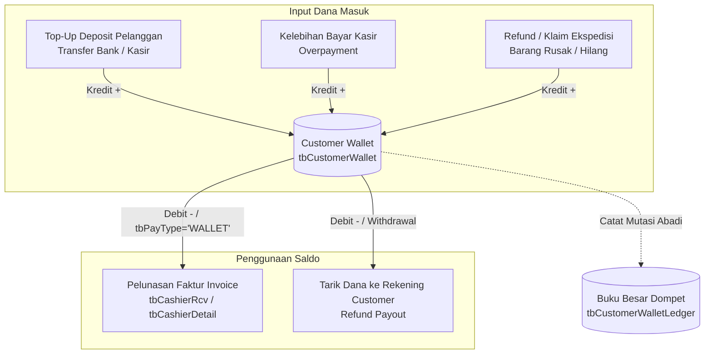
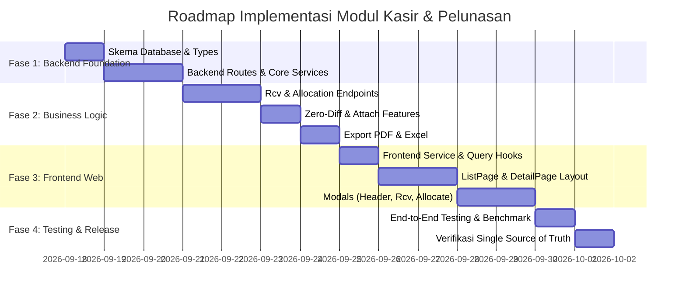

# 📋 Rencana Implementasi: Modul Cashier & Endpoint Backend API (Pelunasan Piutang)

Dokumen ini berisi rencana implementasi teknis dan arsitektur menyeluruh untuk memigrasikan serta mengadopsi fungsionalitas **Pelunasan Pembayaran Piutang (Cashier Register)** dari Visual FoxPro (`frm_regpayment.scx`, `frm_inputpay2.scx`, `frm_inputRcv.scx`, `frm_checkBilling.scx`) ke dalam ekosistem modern **mshipping** (Backend Hono + Bun + Prisma + MSSQL dan Frontend React 19 + TypeScript + Vite).

---

## 🎯 1. Sasaran & Ruang Lingkup Proyek

1. **Digitalisasi Penuh Kasir Pembayaran Piutang**:
   - Menggantikan proses manual/legacy Visual FoxPro dengan modul web modern yang responsif, cepat, aman, dan berestetika premium (*Midnight Dark Mode Compliant*).
2. **Integritas Data & Keseimbangan Kasir (*Zero-Difference Balancing*)**:
   - Menjamin akurasi finansial 100% antara penerimaan uang (Kas/Bank/Giro) dengan alokasi pemotongan invoice piutang sebelum data dapat difinalisasi.
3. **Penyelarasan dengan Master Data Resmi (Single Source of Truth)**:
   - Seluruh data pelanggan wajib mengacu pada master data `tbCustomers.fdCustName` sesuai konvensi `.agents/AGENTS.md`.
4. **Keamanan Transaksi & Proteksi Posting Akuntansi**:
   - Menerapkan penguncian data otomatis jika transaksi kasir telah diposting ke General Ledger (`fdPost = 1`).

---

## 🏛️ 2. Arsitektur Modul Backend API (`backend/src/modules/cashier/`)

Modul backend akan ditempatkan di `backend/src/modules/cashier/` dengan struktur modular standar:

```text
backend/src/modules/cashier/
├── cashier.routes.ts          # Definisi router Hono, validasi Zod, dan route handler
├── cashier.service.ts         # Logika bisnis utama, query Prisma & SQL Server
├── cashier-rcv.service.ts     # Logika bisnis penerimaan uang kas/bank/giro
├── cashier-detail.service.ts  # Logika alokasi pelunasan faktur invoice
├── cashier.types.ts           # Interface TypeScript, Zod schemas, dan DTO
└── cashier.utils.ts           # Auto-number generator format RR, math calculator
```

### 2.1 Spesifikasi Lengkap Endpoint REST API

Semua endpoint dilindungi oleh JWT Middleware (`authenticate`) dan rate limiter:

| Method | Path Endpoint | Fungsi & Deskripsi | Query / Body Payload |
|---|---|---|---|
| **GET** | `/api/cashier` | Menampilkan daftar transaksi register kasir resmi `RR-` (paginated) | `page`, `limit`, `startDate`, `endDate`, `search`, `custCode`, `postStatus` |
| **GET** | `/api/cashier/temp` | Menampilkan daftar kasir sementara `TR-` (`tb2Cashier`) | `page`, `limit`, `startDate`, `endDate`, `search`, `custCode`, `isAttached` |
| **GET** | `/api/cashier/temp/unattached` | Daftar kasir sementara yang belum di-attach ke kasir resmi | `custCode?`, `search?` |
| **GET** | `/api/cashier/stats` | Kartu metrik KPI kasir (Penerimaan Hari Ini, Pelunasan Faktur, Kasir Unbalanced, Pending Temp TR) | `startDate`, `endDate` |
| **GET** | `/api/cashier/master-data` | Mengambil master penunjang kasir (`tbPayType`, `tbMataUang`, `tbBank`) | - |
| **GET** | `/api/cashier/unpaid-invoices/:custCode` | Mengambil daftar faktur piutang customer yang belum lunas (`fdJumlah - fdbayar > 0`) | `search`, `limit` |
| **GET** | `/api/cashier/next-number` | Menghasilkan pratinjau nomor kasir berikutnya sesuai mode (`RR-` resmi atau `TR-` sementara, reset tiap bulan) | `type: 'OFFICIAL' \| 'TEMPORARY'`, `date: YYYY-MM-DD` |
| **GET** | `/api/cashier/:id` | Mengambil detail lengkap kasir (resmi / sementara): Header, Rcv (uang masuk), Details (faktur), dan selisih | - |
| **POST** | `/api/cashier` | Membuat register kasir resmi baru (`tbCashier`, format `RR-000001-MM-YYYY`) | `{ custCode, cashierDate, notes?, attachTempId? }` |
| **POST** | `/api/cashier/temp` | Membuat register pembayaran sementara baru (`tb2Cashier`, format `TR-000001-MM-YYYY`, `fdCode='B'`) | `{ custCode, cashierDate, notes? }` |
| **PUT** | `/api/cashier/:id` | Mengubah header register kasir (hanya jika `fdPost <> 1`) | `{ cashierDate, notes? }` |
| **DELETE** | `/api/cashier/:id` | Menghapus transaksi kasir beserta seluruh rincian (hanya jika `fdPost <> 1`) | - |
| **POST** | `/api/cashier/:id/rcv` | Menambahkan baris penerimaan uang (Kas/Bank/Giro) ke `tbCashierRcv` / `tb2CashierRcv` | `{ type, ccyCode, currValue, amount, bankId1?, giroNo?, giroDate?, validDate?, bankId2? }` |
| **PUT** | `/api/cashier/:id/rcv/:rcvId` | Mengubah nominal/rincian baris penerimaan kas/bank/giro | `{ type, ccyCode, currValue, amount, bankId1?, giroNo?, giroDate?, validDate?, bankId2? }` |
| **DELETE** | `/api/cashier/:id/rcv/:rcvId` | Menghapus baris penerimaan uang dan menghitung ulang total | - |
| **POST** | `/api/cashier/:id/allocate` | Batch alokasi pelunasan faktur invoice ke `tbCashierDetail` / `tb2CashierDetail` | `{ invoices: [{ invNo, amount, ccyCode, currValue }] }` |
| **PUT** | `/api/cashier/:id/details/:detailId` | Mengubah nominal alokasi faktur tertentu | `{ amount }` |
| **DELETE** | `/api/cashier/:id/details/:detailId` | Menghapus alokasi faktur tertentu dan mengembalikan sisa piutang | - |
| **POST** | `/api/cashier/attach` | Mengonversi/melampirkan kasir sementara (`TR-...`) menjadi kasir resmi (`RR-...`) | `{ tempCashierId, officialCashierDate?, notes? }` |
| **GET** | `/api/cashier/:id/print` | Menghasilkan dokumen cetak Bukti Kasir PDF resmi (standar `rpf_cashier`) | `mode: 'pdf' \| 'raw'` |
| **GET** | `/api/cashier/:id/export-excel` | Mengunduh rincian kasir dalam format Excel (`.xlsx`) | - |

---

### 2.2 Skema Validasi Request (Zod Schemas)

```typescript
// cashier.types.ts
import { z } from 'zod'

export const CreateCashierHeaderSchema = z.object({
  custCode: z.string().min(1, 'Customer code wajib diisi').max(20),
  cashierDate: z.string().regex(/^\d{4}-\d{2}-\d{2}$/, 'Format tanggal YYYY-MM-DD wajib'),
  notes: z.string().optional(),
})

export const AddCashierRcvSchema = z.object({
  type: z.enum(['CASH', 'TRANSFER', 'GIRO', 'CASH BACK', 'OTHER']),
  ccyCode: z.string().default('RP.'),
  currValue: z.number().positive().default(1.0),
  amount: z.number().positive('Nominal pembayaran harus lebih besar dari 0'),
  bankId1: z.string().optional().nullable(),
  giroNo: z.string().optional().nullable(),
  giroDate: z.string().optional().nullable(),
  validDate: z.string().optional().nullable(),
  bankId2: z.string().optional().nullable(),
}).refine(data => {
  if (data.type === 'TRANSFER' && !data.bankId1) {
    return false // Bank tujuan wajib jika transfer
  }
  if (data.type === 'GIRO' && (!data.giroNo || !data.giroDate || !data.validDate)) {
    return false // Info warkat wajib jika giro
  }
  return true
}, {
  message: 'Field bank dan warkat giro wajib diisi lengkap sesuai tipe pembayaran',
})

export const BatchAllocateInvoiceSchema = z.object({
  invoices: z.array(z.object({
    invNo: z.string().min(1),
    amount: z.number().positive(),
    ccyCode: z.string().default('RP.'),
    currValue: z.number().positive().default(1.0),
  })).min(1, 'Minimal satu invoice harus dipilih'),
})
```

---

### 2.3 Logika Penomoran Otomatis & Reset Setiap Bulan (Monthly Reset Numbering)

Sesuai instruksi khusus pengguna: **Format resmi nomor kasir adalah `RR-000001-01(BULAN)-2011(TAHUN)` dan urutan nomor WAJIB di-reset kembali ke 1 (`000001`) setiap awal bulan baru**.

#### A. Format Resmi Nomor Register Kasir
- **Format**: `RR-XXXXXX-MM-YYYY`
  - `RR-` : Prefix tetap (*Receipt Register / Kasir Pelunasan*).
  - `XXXXXX` : 6 digit nomor urut (*counter*) dengan leading zero (`000001` s/d `999999`) yang **reset setiap bulan**.
  - `MM` : 2 digit bulan transaksi kasir (`01` s/d `12`).
  - `YYYY` : 4 digit tahun transaksi kasir (misal `2011`, `2026`).

#### B. Contoh Siklus Reset Bulanan
- **Transaksi Bulan September 2026 (`-09-2026`)**:
  - Transaksi ke-1: `RR-000001-09-2026`
  - Transaksi ke-2: `RR-000002-09-2026`
  - Transaksi ke-150: `RR-000150-09-2026`
- **Berganti ke Bulan Oktober 2026 (`-10-2026`)**:
  - **OTOMATIS RESET KEMBALI KE 1**:
  - Transaksi ke-1: `RR-000001-10-2026`
  - Transaksi ke-2: `RR-000002-10-2026`
- **Berganti ke Bulan Januari 2027 (`-01-2027`)**:
  - **OTOMATIS RESET KEMBALI KE 1**:
  - Transaksi ke-1: `RR-000001-01-2027`

#### C. Algoritma Generator Nomor Kasir (Thread-Safe & Anti-Collision)
Generator nomor kasir dijalankan di dalam blok transaksi database Prisma dengan isolasi serializable / lock update:

```typescript
// cashier.utils.ts
export async function generateMonthlyCashierId(
  cashierDate: Date | string,
  tx: any
): Promise<string> {
  const d = typeof cashierDate === 'string' ? new Date(cashierDate) : cashierDate
  const mm = String(d.getMonth() + 1).padStart(2, '0') // 2 digit bulan (01-12)
  const yyyy = String(d.getFullYear())                  // 4 digit tahun (e.g. 2026)
  const suffix = `-${mm}-${yyyy}`                       // Contoh: '-09-2026'

  // Query nomor tertinggi pada bulan dan tahun terpilih dengan update lock
  // Karena nomor urut berada di awal (setelah 'RR-'), sorting DESC secara alami mengurutkan sequence numerik
  const latestRows: any[] = await tx.$queryRawUnsafe(`
    SELECT TOP 1 fdCashierID
    FROM tbCashier WITH (UPDLOCK, HOLDLOCK)
    WHERE fdCashierID LIKE 'RR-%${suffix}'
    ORDER BY fdCashierID DESC
  `)

  let nextSequence = 1
  if (latestRows && latestRows.length > 0 && latestRows[0].fdCashierID) {
    const rawId = String(latestRows[0].fdCashierID).trim()
    const parts = rawId.split('-')
    if (parts.length >= 4) {
      // Format: RR-XXXXXX-MM-YYYY -> parts[1] adalah 6-digit sequence
      const lastSeq = parseInt(parts[1], 10)
      if (!isNaN(lastSeq) && lastSeq >= 1) {
        nextSequence = lastSeq + 1
      }
    }
  }

  const paddedSeq = String(nextSequence).padStart(6, '0')
  return `RR-${paddedSeq}${suffix}` // Hasil: 'RR-000001-09-2026'
}
```

#### D. Auto-Number Baris Unik Detail (`fdID` pada `tbCashierRcv` & `tbCashierDetail`)
Untuk baris detail penerimaan uang dan alokasi faktur, sistem tetap menggunakan counter global thread-safe dari tabel master:
- `tbMasterCounter WHERE fdCode = 'A'`:
  - `fdCRCounter`: Counter baris `tbCashierRcv.fdID` (atomic increment, 7 digit: `0000001`).
  - `fdCDCounter`: Counter baris `tbCashierDetail.fdID` (atomic increment, 7 digit: `0000001`).

---

### 2.4 Struktur Data Master Penunjang Kasir (`tbBank`, `tbMataUang`, `tbPayType`)

Endpoint `GET /api/cashier/master-data` mengonsolidasikan 3 tabel master pendukung transaksi kasir:

#### A. Master Mata Uang (`tbMataUang`)
- **Query**: `SELECT * FROM tbMataUang ORDER BY fdIndex`
- **Kolom Kunci**:
  - `fdCCYCode`: Kode mata uang unik (contoh: `'RP.'`, `'USD'`, `'RMB'`, dll).
  - `fdCCYName`: Nama mata uang (contoh: `'Rupiah'`, `'US Dollar'`, dll).
  - `fdCCYValue`: Nilai konversi / kurs terhadap Rupiah (`IDR`).
- **Logika Kasir**: Saat user memilih mata uang pada dropdown `fdCCYCode`, nilai kurs `fdCurrValue` otomatis tersinkronisasi dari `tbMataUang.fdCCYValue` (default: 1.00 untuk `'RP.'`).

#### B. Master Bank (`tbBank`)
- **Query**: `SELECT * FROM tbBank ORDER BY fdBankCode`
- **Kolom Kunci**:
  - `fdBankCode`: Kode unik bank / `BANKCODE` (contoh: `'BCB'`, `'MND'`, `'BRI'`, `'BNI'`, dll).
  - `fdBankName`: Nama lengkap bank (contoh: `'Bank Central Asia'`, `'Bank Mandiri'`, dll).
- **Logika Kasir**:
  - `fdBankID1` (Bank Penampung/Tujuan): Rekening bank perusahaan tempat dana masuk.
  - `fdBankID2` (Bank Asal/Tertarik): Bank penerbit warkat giro pelanggan.
  - Jika tipe pembayaran `TRANSFER`: Sistem otomatis mengisi bank tujuan default ke `'BCB'` (BCA).

#### C. Master Tipe Pembayaran (`tbPayType`)
- **Query**: `SELECT * FROM tbPayType ORDER BY fdPayCode`
- **Opsi Utama**: `CASH`, `TRANSFER`, `GIRO`, `CASH BACK`.
- **Logika Kondisional**:
  - `CASH`: Me-reset & mematikan field bank dan warkat giro.
  - `TRANSFER`: Mengaktifkan field bank tujuan (default `'BCB'`).
  - `GIRO`: Mengaktifkan seluruh input warkat giro (nomor giro, bank penerbit, tanggal giro, dan tanggal efektif kliring).

---

### 2.5 Arsitektur Modul Pembayaran Sementara (`fr3_regpayment` / `TR-` Series) & Alur Attach

Sistem kasir mshipping mengadopsi model **Dua Lapisan (Two-Tier Receipt System)** dari Visual FoxPro:
1. **Tier 1: Pembayaran Sementara (`TR-` Series / `fr3_regpayment.scx`)**:
   - Ditujukan untuk kasir lapangan atau front office yang menerima titipan/uang muka/pembayaran belum final.
   - Tabel terisolasi: `tb2Cashier`, `tb2CashierRcv`, `tb2CashierDetail`.
   - Counter sequence tersendiri: `tbMasterCounter` dengan `fdCode = 'B'`.
   - Format nomor: `TR-XXXXXX-MM-YYYY` (Sequence 6-digit reset bulanan, contoh `TR-000001-09-2026`).
   - Tidak langsung mempengaruhi pembukuan akuntansi (staging buffer).
2. **Tier 2: Kasir Resmi Permanen (`RR-` Series / `frm_regpayment.scx`)**:
   - Dikelola oleh bagian Finance / Accounting.
   - Tabel utama: `tbCashier`, `tbCashierRcv`, `tbCashierDetail`.
   - Counter sequence: `tbMasterCounter` dengan `fdCode = 'A'`.
   - Format nomor: `RR-XXXXXX-MM-YYYY` (Sequence 6-digit reset bulanan, contoh `RR-000001-09-2026`).
   - Siap diposting ke General Ledger (`fdPost = 1`).

#### Alur Transaksi Attach (`POST /api/cashier/attach`):
```typescript
// Transaksi atomik konversi TR ke RR:
export async function attachTempReceiptToOfficial(tempCashierId: string, officialDate: string, loginId: string) {
  return await prisma.$transaction(async (tx) => {
    // 1. Ambil data kasir sementara
    const tempHeader = await tx.tb2Cashier.findUnique({ where: { fdCashierID: tempCashierId } })
    if (!tempHeader) throw new Error('Kasir sementara tidak ditemukan')
    
    // 2. Generate nomor kasir resmi berikutnya (RR-XXXXXX-MM-YYYY)
    const officialId = await generateNextOfficialCashierId(officialDate)
    
    // 3. Buat header tbCashier resmi dengan ref ke tempCashierId
    await tx.tbCashier.create({
      data: {
        fdCashierID: officialId,
        fdCashierDate: new Date(officialDate),
        fdCustCode: tempHeader.fdCustCode,
        fdDescr: tempHeader.fdDescr,
        fdCreated: loginId,
        fdCashierXX: tempCashierId, // Referensi asal kasir sementara
        fdPost: 0,
      }
    })
    
    // 4. Salin baris penerimaan tb2CashierRcv -> tbCashierRcv
    const tempRcvs = await tx.tb2CashierRcv.findMany({ where: { fdCashierID: tempCashierId } })
    for (const rcv of tempRcvs) {
      const nextRcvId = await getNextMasterCounterId('A', 'fdCRCounter')
      await tx.tbCashierRcv.create({
        data: {
          ...rcv,
          fdCashierID: officialId,
          fdID: nextRcvId,
        }
      })
    }
    
    // 5. Salin baris alokasi tb2CashierDetail -> tbCashierDetail
    const tempDetails = await tx.tb2CashierDetail.findMany({ where: { fdCashierID: tempCashierId } })
    for (const dtl of tempDetails) {
      const nextDtlId = await getNextMasterCounterId('A', 'fdCDCounter')
      await tx.tbCashierDetail.create({
        data: {
          ...dtl,
          fdCashierID: officialId,
          fdID: nextDtlId,
        }
      })
    }
    
    // 6. Tandai kasir sementara sudah di-attach
    await tx.tb2Cashier.update({
      where: { fdCashierID: tempCashierId },
      data: { fdPost: 1 } // Mengunci temp receipt agar tidak di-attach ganda
    })
    
    return { officialId, tempCashierId }
  })
}
```

---

## 🎨 3. Arsitektur Frontend Web ERP (`frontend/src/features/cashier/` atau `billing/`)

Komponen UI akan diintegrasikan pada menu navigasi ERP Finance di bawah domain `Billing & Pelunasan`.

### 3.1 Struktur Komponen Frontend

```text
frontend/src/features/cashier/
├── components/
│   ├── CashierToolbar.tsx            # Search bar, date range picker, filter status posting, toggle mode RR vs TR
│   ├── CashierTable.tsx              # Tabel ringkasan transaksi kasir (mendukung mode Resmi & Sementara)
│   ├── CashierKpiGrid.tsx            # 4 kartu KPI metrik penerimaan, pelunasan, dan antrean kasir sementara
│   ├── CashierHeaderModal.tsx        # Modal buat/edit header kasir resmi (RR)
│   ├── TempReceiptModal.tsx          # Modal buat/edit tanda terima kasir sementara (TR)
│   ├── AttachTempReceiptModal.tsx    # Modal pencarian & import kasir sementara (ekuivalen frm_inputpay_attach)
│   ├── PaymentReceivedModal.tsx      # Modal tambah/edit penerimaan kas/bank/giro (ekuivalen frm_inputRcv)
│   ├── InvoiceAllocationModal.tsx    # Modal checklist faktur belum lunas (ekuivalen frm_checkBilling)
│   ├── BillingAdjustmentModal.tsx    # Modal penyesuaian nominal billing (ekuivalen frm_Billing2)
│   ├── BalanceIndicatorBadge.tsx     # Badge indikator keseimbangan selisih kasir (Zero-Diff)
│   └── Skeletons/                    # Skeleton shimmer loading states
├── hooks/
│   ├── useCashierList.ts             # React Query hook untuk list kasir (mendukung query type: 'OFFICIAL' | 'TEMPORARY')
│   ├── useCashierDetail.ts           # React Query hook untuk detail kasir
│   └── useUnpaidInvoices.ts          # React Query hook untuk daftar invoice piutang
├── pages/
│   ├── ListPage.tsx                  # Halaman daftar transaksi kasir dengan Tab Resmi (RR) & Sementara (TR)
│   └── DetailPage.tsx                # Halaman meja kerja kasir (/finance/cashier/:id)
├── services/
│   └── cashier.service.ts            # Panggilan Axios ke backend /api/cashier
├── stores/
│   └── cashierStore.ts               # Local zustand state untuk draft alokasi kasir
└── types/
    └── cashier.types.ts              # TypeScript interfaces & DTOs
```

### 3.2 Desain Halaman Meja Kerja Kasir (`DetailPage.tsx`)
Halaman ini menyatukan orkestrasi `frm_regpayment.scx` dalam antarmuka modern yang lapang dan intuitif:

```text
+----------------------------------------------------------------------------------------------------+
| PageHeader: Kasir & Pelunasan Piutang  [#RR-000125-09-2026]         [ Cetak PDF ] [ Export Excel ]    |
| Breadcrumbs: Modul Keuangan > Billing & Pelunasan > Registrasi Kasir                               |
+----------------------------------------------------------------------------------------------------+
| KARTU RINGKASAN KASIR                                                                              |
| Pelanggan : PT. SAMUDERA JAYA (C0012)        Tanggal Kasir : 17 Sep 2026                           |
| Dibuat Oleh: NOVI                            Status Posting: [ TERBUKA / OPEN ]                    |
+----------------------------------------------------------------------------------------------------+
| INDIKATOR KESEIMBANGAN FINANCIAL (BALANCE BAR)                                                     |
| [ Total Uang Masuk: Rp 15.000.000 ]  [ Total Faktur: Rp 15.000.000 ]  [ STATUS: SEIMBANG (Rp 0) ]  |
+----------------------------------------------------------------------------------------------------+
| TAB 1: PENERIMAAN DANA (KAS / BANK / GIRO)             [ + Tambah Penerimaan (PaymentReceivedModal) ]
| +-------+--------+-------------+---------------+---------------+--------------------+-------------+
| | Tipe  | Curr   | Kurs        | Jumlah (IDR)  | Bank Tujuan   | Info Giro / Warkat | Aksi        |
| +-------+--------+-------------+---------------+---------------+--------------------+-------------+
| | TRF   | RP.    | 1.00        | 10.000.000,00 | BCA (BCB)     | Trf Tgl 17/09/2026 | [Edit][Del] |
| | CASH  | RP.    | 1.00        | 5.000.000,00  | -             | Tunai di Kasir     | [Edit][Del] |
| +-------+--------+-------------+---------------+---------------+--------------------+-------------+
+----------------------------------------------------------------------------------------------------+
| TAB 2: ALOKASI FAKTUR INVOICE                          [ + Ambil Faktur (InvoiceAllocationModal) ]  |
| +----------+------------+---------------+-------------+-------------------+-----------------------+
| | No. Inv  | Tgl Faktur | Total Tagihan | Sisa Piutang| Nominal Dilunasi  | Aksi                  |
| +----------+------------+---------------+-------------+-------------------+-----------------------+
| | 26010045 | 10/09/2026 | 5.000.000,00  | 5.000.000,00| 5.000.000,00      | [Edit Nominal] [Del]  |
| | 26010098 | 12/09/2026 | 12.000.000,00 | 10.000.000,0| 10.000.000,00     | [Edit Nominal] [Del]  |
| +----------+------------+---------------+-------------+-------------------+-----------------------+
+----------------------------------------------------------------------------------------------------+
```

### 3.3 Standar Desain UI/UX ERP (Sesuai `AGENTS.md`)
- **Midnight Dark Mode Compliant**:
  - Dilarang `bg-white` pada tab aktif atau tombol.
  - Menggunakan outline border semantik (`border-[var(--color-border)]`, `border-[var(--color-tertiary)]`).
  - Badge seimbang: `border border-emerald-500/40 text-emerald-400 bg-transparent`.
  - Badge selisih tidak seimbang: `border border-rose-500/50 text-rose-400 bg-rose-500/10 animate-pulse font-bold`.
- **Standar Skala Font & Spacing**:
  - Judul modal: 15px font-bold uppercase tracking-wide.
  - Kartu KPI: 18px font-bold tabular-nums.
  - Header tabel kolom: 11px uppercase tracking-wider font-semibold padding `py-2 px-3`.
  - Teks baris tabel data: 12px tabular-nums.
- **Loading State**:
  - Menggunakan wireframe skeleton `.skeleton-shimmer` saat initial load.

---

### 3.4 Matriks Hak Akses & Peran Pengguna (Role-Based Access Control / RBAC)

Modul Kasir mengintegrasikan sistem permission yang tersimpan pada tabel `tbRolePermissions` dan divalidasi melalui middleware backend `requirePermission('/mshipping/finance/cashier')` serta otorisasi conditional rendering di frontend:

| Hak Akses / Aksi Finansial | Admin / Super Admin (`admin`) | Finance / Accounting (`finance`) | Kasir Lapangan / Front Office (`cashier`) | Auditor / Management (`viewer`) |
|---|:---:|:---:|:---:|:---:|
| **Lihat Daftar & Detail Kasir** | ✅ Penuh | ✅ Penuh | ✅ Terbatas (Draft/Temp) | 👁️ Read-Only |
| **Input Pembayaran Sementara (`TR-`)** | ✅ Penuh | ✅ Penuh | ✅ Penuh (Fitur Utama) | ❌ Tidak |
| **Input Kasir Resmi (`RR-`)** | ✅ Penuh | ✅ Penuh | ❌ (Wajib Verifikasi Finance) | ❌ Tidak |
| **Attach Pembayaran Sementara (`TR-` $\to$ `RR-`)** | ✅ Penuh | ✅ Penuh | ❌ Tidak | ❌ Tidak |
| **Input / Edit Penerimaan Uang (`tbCashierRcv`)** | ✅ Penuh | ✅ Penuh (Jika belum post) | ✅ (Hanya pada `tb2CashierRcv`) | ❌ Tidak |
| **Alokasi Faktur Piutang (`tbCashierDetail`)** | ✅ Penuh | ✅ Penuh (Jika belum post) | ✅ (Draft alokasi sementara) | ❌ Tidak |
| **Hapus Transaksi Kasir (`DELETE`)** | ✅ Penuh | ✅ Penuh (Hanya jika belum post)| ❌ Tidak | ❌ Tidak |
| **Bypass Kunci Posting Akuntansi (`fdPost = 1`)** | ✅ (Super Admin Only)| ❌ Terkunci Otomatis | ❌ Terkunci Otomatis | ❌ Terkunci Otomatis |
| **Cetak PDF Bukti Kasir & Ekspor Excel** | ✅ Penuh | ✅ Penuh | ✅ Cetak Bukti Sementara | ✅ Cetak & Ekspor |

#### Logika Proteksi Transaksional:
1. **Aturan `fdPost = 1` (Accounting Lock)**:
   - Jika `tbCashier.fdPost === 1`, seluruh tombol `Edit`, `Hapus`, `Tambah Penerimaan`, `Alokasi Faktur`, dan `Attach` otomatis di-disable di frontend dan ditolak dengan status **HTTP 403 Forbidden** di backend.
2. **Audit Trail**:
   - Kolom `fdCreated` diisi otomatis dari identitas akun yang melakukan transaksi (`c.get('user').username`), menjamin akuntabilitas penuh pada setiap kuitansi.

---

### 3.5 Arsitektur Sistem Dual Bahasa (i18n ID / EN)

Sesuai aturan wajib `.agents/AGENTS.md`, seluruh teks visual pada modul kasir **DILARANG DI-HARDCODE** dan wajib menggunakan hook `useTranslation()` dengan kamus tersinkronisasi simetris di `frontend/src/lib/i18n/id.json` dan `en.json`.

#### Daftar Kamus Terjemahan Namespace `cashier.*`:

| Key i18n | Bahasa Indonesia (`id.json`) | English (`en.json`) |
|---|---|---|
| `nav.cashier` | Kasir & Pelunasan | Cashier & Settlement |
| `cashier.title` | Meja Kasir & Pelunasan Piutang | Cashier & Receivable Settlement |
| `cashier.subtitle` | Registrasi penerimaan uang kas/bank/giro dan alokasi pelunasan faktur | Cash/bank/giro receipt registration and invoice settlement |
| `cashier.tab.official` | Kasir Resmi (RR) | Official Receipts (RR) |
| `cashier.tab.temporary` | Pembayaran Sementara (TR) | Temporary Receipts (TR) |
| `cashier.tab.unattached` | Menunggu Attach | Pending Attach |
| `cashier.kpi.todayReceived` | Penerimaan Hari Ini | Today's Receipts |
| `cashier.kpi.settledInvoices` | Faktur Dilunasi | Settled Invoices |
| `cashier.kpi.unbalancedCount`| Kasir Belum Seimbang | Unbalanced Cashier |
| `cashier.kpi.pendingTemp` | Kasir Sementara Pending | Pending Temporary Receipts |
| `cashier.balance.balanced` | SEIMBANG (Rp 0) | BALANCED (Rp 0) |
| `cashier.balance.unbalanced` | SELISIH: {amount} | DIFFERENCE: {amount} |
| `cashier.balance.unbalancedHint`| Penerimaan uang belum sesuai dengan nilai faktur | Received funds do not match allocated invoices |
| `cashier.rcv.title` | Rincian Penerimaan Dana | Payment Received Details |
| `cashier.rcv.btnAdd` | Tambah Penerimaan | Add Received Payment |
| `cashier.rcv.type` | Tipe Pembayaran | Payment Type |
| `cashier.rcv.cash` | Tunai (Cash) | Cash |
| `cashier.rcv.transfer` | Transfer Bank | Bank Transfer |
| `cashier.rcv.giro` | Giro / Cek / Warkat | Cheque / Giro |
| `cashier.rcv.destBank` | Rekening Bank Tujuan | Destination Bank |
| `cashier.rcv.giroNo` | Nomor Giro / Warkat | Cheque / Giro No. |
| `cashier.rcv.giroDate` | Tanggal Jatuh Tempo | Due Date |
| `cashier.rcv.validDate` | Tanggal Efektif Kliring | Clearing Date |
| `cashier.rcv.originBank` | Bank Penerbit Warkat | Issuing Bank |
| `cashier.allocate.title` | Alokasi Faktur Tagihan | Invoice Allocation |
| `cashier.allocate.btnSelect` | Ambil Faktur Belum Lunas | Pick Unpaid Invoices |
| `cashier.allocate.invNo` | No. Faktur Tagihan | Invoice No. |
| `cashier.allocate.invDate` | Tanggal Faktur | Invoice Date |
| `cashier.allocate.totalBill` | Total Tagihan | Total Bill |
| `cashier.allocate.balance` | Sisa Piutang | Remaining Balance |
| `cashier.allocate.payAmount` | Nominal Dilunasi | Paid Amount |
| `cashier.attach.modalTitle` | Tarik dari Pembayaran Sementara | Attach from Temporary Receipt |
| `cashier.attach.modalDesc` | Pilih kuitansi sementara (TR-) yang akan diterbitkan menjadi kasir resmi (RR-) | Select temporary receipt (TR-) to convert into official receipt (RR-) |
| `cashier.attach.btnAttach` | Konversi ke Kasir Resmi | Convert to Official Receipt |
| `cashier.attach.success` | Berhasil meng-attach kasir sementara ke {id} | Successfully attached temporary receipt to {id} |
| `cashier.alert.postedLocked` | Transaksi ini telah diposting ke akuntansi dan terkunci | This transaction has been posted to accounting and is locked |
| `cashier.confirm.deleteHeader` | Apakah Anda yakin ingin menghapus transaksi kasir ini? | Are you sure you want to delete this cashier transaction? |
| `cashier.confirm.deleteItem` | Konfirmasi hapus baris ini? | Confirm deleting this item? |

---

## 💼 4. Rancang Bangun Sistem Baru: Customer Wallet / Saldo Deposit Pelanggan

Sistem wallet pelanggan adalah modul baru mshipping yang dirancang untuk mengelola **saldo deposit / uang muka (advance payment)** pelanggan, menampung **kelebihan bayar (overpayment)** dari kasir, dan menyediakan metode pembayaran instan saat pelunasan faktur tanpa harus transfer berulang kali.



### 4.1 Desain Skema Database Baru (Prisma & MSSQL)

Sistem wallet menggunakan arsitektur **Double-Entry Append-Only Ledger** untuk menjamin akuntabilitas finansial 100%:

```prisma
// Penambahan pada schema.prisma:

/// Tabel Saldo Dompet Pelanggan (Header / Current Balance)
model TbCustomerWallet {
  fdWalletID    String    @id @default(uuid()) @db.NVarChar(50)
  fdCustCode    String    @unique @db.NVarChar(20)
  fdBalance     Decimal   @default(0.00) @db.Decimal(18, 2)
  fdCurrency    String    @default("RP.") @db.NVarChar(10)
  fdStatus      String    @default("ACTIVE") @db.NVarChar(20) // ACTIVE, FROZEN, CLOSED
  fdLastUpdated DateTime  @default(now()) @db.DateTime
  fdUpdatedBy   String?   @db.NVarChar(50)

  // Relasi
  customer      TbCustomers @relation(fields: [fdCustCode], references: [fdCustCode])
  ledgers       TbCustomerWalletLedger[]

  @@map("tbCustomerWallet")
}

/// Tabel Buku Besar Mutasi Dompet (Immutable Ledger - Append-Only)
model TbCustomerWalletLedger {
  fdLedgerID      BigInt    @id @default(autoincrement())
  fdWalletID      String    @db.NVarChar(50)
  fdCustCode      String    @db.NVarChar(20)
  fdTxType        String    @db.NVarChar(30) // TOPUP, PAYMENT, OVERPAYMENT, REFUND, WITHDRAWAL, ADJUSTMENT
  fdDirection     String    @db.NVarChar(10) // CREDIT (+), DEBIT (-)
  fdAmount        Decimal   @db.Decimal(18, 2)
  fdBalanceBefore Decimal   @db.Decimal(18, 2)
  fdBalanceAfter  Decimal   @db.Decimal(18, 2)
  fdRefType       String    @db.NVarChar(30) // CASHIER, INVOICE, BANK_TRANSFER, MANUAL
  fdRefNo         String?   @db.NVarChar(50) // RR-..., TR-..., No Rekening
  fdNotes         String?   @db.NVarChar(255)
  fdCreatedDate   DateTime  @default(now()) @db.DateTime
  fdCreatedBy     String    @db.NVarChar(50)

  // Relasi
  wallet          TbCustomerWallet @relation(fields: [fdWalletID], references: [fdWalletID])

  @@index([fdCustCode, fdCreatedDate])
  @@index([fdRefNo])
  @@map("tbCustomerWalletLedger")
}
```

### 4.2 Aturan Bisnis & Integritas Saldo Wallet

1. **Non-Negative Balance Constraint**:
   - Saldo wallet **dilarang bernilai minus** (`fdBalance >= 0`). Jika transaksi debit melebihi saldo aktif, transaksi otomatis ditolak dengan error *"Saldo wallet tidak mencukupi"*.
2. **Pessimistic Concurrency Locking**:
   - Setiap mutasi saldo dieksekusi dalam database transaction dengan kueri ber-lock:
     ```sql
     SELECT fdBalance FROM tbCustomerWallet WITH (UPDLOCK, HOLDLOCK) WHERE fdCustCode = @custCode
     ```
   - Menjamin nol risiko *race condition* atau pemotongan ganda saat transaksi simultan.
3. **Immutable Ledger (Append-Only)**:
   - Baris pada `tbCustomerWalletLedger` **tidak boleh di-UPDATE atau di-DELETE**.
   - Jika terjadi kekeliruan, dilakukan pencatatan mutasi balik bertipe `ADJUSTMENT` dengan otorisasi khusus Finance Supervisor.

### 4.3 Integrasi Wallet dengan Modul Kasir Pelunasan

1. **Pembayaran Tagihan Menggunakan Wallet (`tbPayType = 'WALLET'`)**:
   - Pada modal penerimaan uang (`PaymentReceivedModal`), kasir dapat memilih tipe: **`WALLET (SALDO DEPOSIT)`**.
   - Sistem menampilkan saldo aktif customer. Kasir memasukkan jumlah pemotongan.
   - Saat kasir disimpan:
     - Saldo wallet dipotong secara atomik (`DEBIT`).
     - Baris `tbCashierRcv` tercatat dengan tipe `WALLET`.
     - Ledger wallet mencatat mutasi dengan `fdRefNo = fdCashierID`.
2. **Otomatisasi Kelebihan Bayar ke Wallet (Overpayment Catching)**:
   - Jika uang yang diterima kasir lebih besar dari tagihan faktur (`fdJumlah1 > fdJumlah2`), muncul sakelar opsi:
     - ☑️ **"Alihkan sisa lebih bayar (Rp 150.000) ke Saldo Wallet Pelanggan"**.
     - Sistem otomatis mengkreditkan selisih ke wallet customer, sehingga kasir resmi tetap seimbang (`fdSelisih = 0`).
3. **Top-Up Saldo Mandiri / Kasir**:
   - Customer menyetor dana deposit via transfer bank / tunai di kasir.
   - Kasir menerbitkan Bukti Deposit Resmi bertipe `TOPUP`.

### 4.4 Daftar Endpoint REST API Customer Wallet (`/api/wallet`)

| Method | Path Endpoint | Deskripsi | Query / Body Payload |
|---|---|---|---|
| **GET** | `/api/wallet/customer/:custCode` | Ambil saldo wallet aktif customer & 10 mutasi terakhir | - |
| **GET** | `/api/wallet/ledger` | Daftar mutasi buku besar wallet (paginated & filter) | `page`, `limit`, `custCode?`, `startDate?`, `endDate?`, `txType?` |
| **GET** | `/api/wallet/stats` | Ringkasan metrik total deposit seluruh customer di sistem | - |
| **POST** | `/api/wallet/topup` | Tambah deposit saldo customer (via Transfer / Kasir) | `{ custCode, amount, paymentMethod, bankId?, refNo?, notes? }` |
| **POST** | `/api/wallet/pay` | Pemotongan saldo wallet untuk kasir / faktur | `{ custCode, cashierId, amount, notes? }` |
| **POST** | `/api/wallet/withdraw` | Penarikan kembali deposit ke rekening pelanggan | `{ custCode, amount, bankName, accountNo, accountName, notes? }` |
| **POST** | `/api/wallet/adjust` | Penyesuaian saldo manual oleh Finance / Admin | `{ custCode, direction: 'CREDIT'\|'DEBIT', amount, reason }` |

---

## 🛣️ 5. Peta Jalan Eksekusi (Phased Implementation Roadmap)



### 🔹 Fase 1: Fondasi Backend API & Integrasi Database
1. Mendefinisikan DTO, tipe data TypeScript, dan Zod schemas di `backend/src/modules/cashier/cashier.types.ts` dan `modules/wallet/wallet.types.ts`.
2. Mengonfirmasi model Prisma `TbCashier`, `TbCashierRcv`, `TbCashierDetail`, `TbCustomerWallet`, `TbCustomerWalletLedger`, dan `TbMasterCounter` di `prisma/schema.prisma`.
3. Membangun `cashier.service.ts` untuk query paginated, KPI stats, lookup pelanggan, dan pembuatan header kasir.
4. Mendaftarkan router `cashierRoutes` (`/api/cashier`) dan `walletRoutes` (`/api/wallet`) pada `backend/src/index.ts`.

### 🔹 Fase 2: Logika Bisnis Penerimaan, Alokasi Faktur, Ekspor, & Wallet
1. Membangun endpoint penerimaan dana (`/api/cashier/:id/rcv`) lengkap dengan logika kondisional `CASH`, `TRANSFER`, `GIRO`, dan `WALLET`.
2. Membangun endpoint alokasi faktur (`/api/cashier/:id/allocate`) yang terhubung langsung dengan sisa piutang `tbBilling`.
3. Membangun logika debit/kredit saldo wallet (`/api/wallet/pay`, `/api/wallet/topup`) dengan pessimistic locking.
4. Mengimplementasikan kalkulator otomatis total, selisih (`fdSelisih`), dan overpayment-to-wallet.
5. Membangun service ekspor PDF tanda terima kasir dan berkas Excel.

### 🔹 Fase 3: Antarmuka Web Frontend ERP (Cashier & Customer Wallet)
1. Menambahkan konstanta rute di `src/lib/constants.ts`:
   - `ROUTES.CASHIER = '/mshipping/finance/cashier'`
   - `ROUTES.CASHIER_DETAIL = (id) => '/mshipping/finance/cashier/' + id`
   - `ROUTES.WALLET = '/mshipping/finance/wallet'`
2. Menyusun service API di `frontend/src/features/cashier/services/cashier.service.ts` dan `wallet.service.ts`.
3. Membangun halaman daftar `ListPage.tsx` lengkap dengan toolbar filter dan indikator status kasir (Resmi & Sementara).
4. Membangun halaman meja kerja kasir `DetailPage.tsx` dengan kartu metrik keseimbangan finansial dan widget saldo wallet.
5. Membangun modal interaktif:
   - `CashierHeaderModal`: Pembuatan kasir baru & pemilih customer autocomplete.
   - `PaymentReceivedModal`: Input instrumen penerimaan kas/bank/giro/wallet dinamis.
   - `InvoiceAllocationModal`: Checklist faktur belum lunas dengan kalkulasi otomatis.
   - `AttachTempReceiptModal`: Pencarian dan import kasir sementara (`TR-` $\to$ `RR-`).
   - `CustomerWalletModal`: Top-up deposit & riwayat mutasi saldo pelanggan.

### 🔹 Fase 4: Pengujian, Validasi Keseimbangan, & Dokumentasi
1. Menulis script benchmark otomatis via Bun untuk memastikan seluruh query kasir dan wallet merespon di bawah < 50ms.
2. Menguji skenario transaksi wallet: pembayaran tagihan memotong saldo, pencegahan saldo negatif, dan pengalihan kelebihan bayar.
3. Menguji skenario proteksi posting akuntansi (`fdPost = 1`).
4. Menguji zero-difference alert saat uang masuk tidak sama dengan nilai faktur yang dilunasi.
5. Memastikan nama customer selalu divalidasi ke master `tbCustomers.fdCustName`.
6. Memperbarui dokumentasi `frontend-app.md` dan `.agents/working.md`.

---

## 🧪 6. Rencana Pengujian & Verifikasi (Verification Plan)

### 6.1 Pengujian Otomatis (Automated Tests)
- Script pengujian API (`backend/scripts/test-cashier-api.ts`):
  1. `POST /api/cashier` $\to$ Berhasil membuat header kasir baru dengan nomor `RR-...`.
  2. `POST /api/cashier/:id/rcv` $\to$ Berhasil menambahkan baris penerimaan kas/bank/wallet.
  3. `GET /api/cashier/unpaid-invoices/:custCode` $\to$ Mengembalikan invoice dengan `sisaPiutang > 0`.
  4. `POST /api/cashier/:id/allocate` $\to$ Berhasil mengalokasikan pembayaran ke invoice.
  5. `POST /api/wallet/topup` & `POST /api/wallet/pay` $\to$ Berhasil mutasi saldo dan verifikasi non-negatif.
  6. `GET /api/cashier/:id` $\to$ Mengembalikan `selisih === 0` (seimbang).
  7. Typecheck TypeScript:
     - Backend: `bun run --bun tsc -b` (Wajib 0 error).
     - Frontend: `bun run build` (Wajib 0 error).

### 5.2 Pengujian Kasus Batas (Edge Cases & Manual Verification)
1. **Kasus Selisih Tidak Seimbang (Unbalanced)**:
   - Kasir menerima Rp 10.000.000 tapi alokasi faktur Rp 8.000.000.
   - Verifikasi bahwa sistem menampilkan badge selisih merah berkedip `Rp 2.000.000` dan menahan tombol posting/finalisasi.
2. **Kasus Giro Belum Jatuh Tempo**:
   - Pembayaran dengan giro di mana `validDate` lebih besar dari tanggal hari ini.
   - Verifikasi bahwa status giro tercatat dengan jelas dan memiliki status kliring terpisah.
3. **Kasus Proteksi Posting (`fdPost = 1`)**:
   - Coba lakukan edit/delete pada transaksi kasir yang sudah diposting.
   - Verifikasi bahwa backend melempar error HTTP 403 / 400 *"Transaksi sudah diposting ke akuntansi dan terkunci"*.
4. **Kasus Single Source of Truth Customer**:
   - Pastikan nama pelanggan yang muncul di header kuitansi kasir adalah nama resmi dari master `tbCustomers.fdCustName`.
5. **Kasus Reset Penomoran Setiap Pergantian Bulan (`RR-000001-MM-YYYY`)**:
   - Buat transaksi kasir pada tanggal akhir bulan (misal `2026-09-30` dengan nomor `RR-000025-09-2026`).
   - Buat transaksi kasir baru pada awal bulan berikutnya (`2026-10-01`).
   - Verifikasi bahwa nomor transaksi kasir otomatis di-reset kembali ke `RR-000001-10-2026`.


---

## 📋 6. Kesiapan Eksekusi

Rencana di atas telah dirancang secara komprehensif dan selaras dengan seluruh aturan arsitektur mshipping. Apakah rencana ini sudah sesuai dengan ekspektasi Anda untuk kita mulai eksekusi bertahap?
