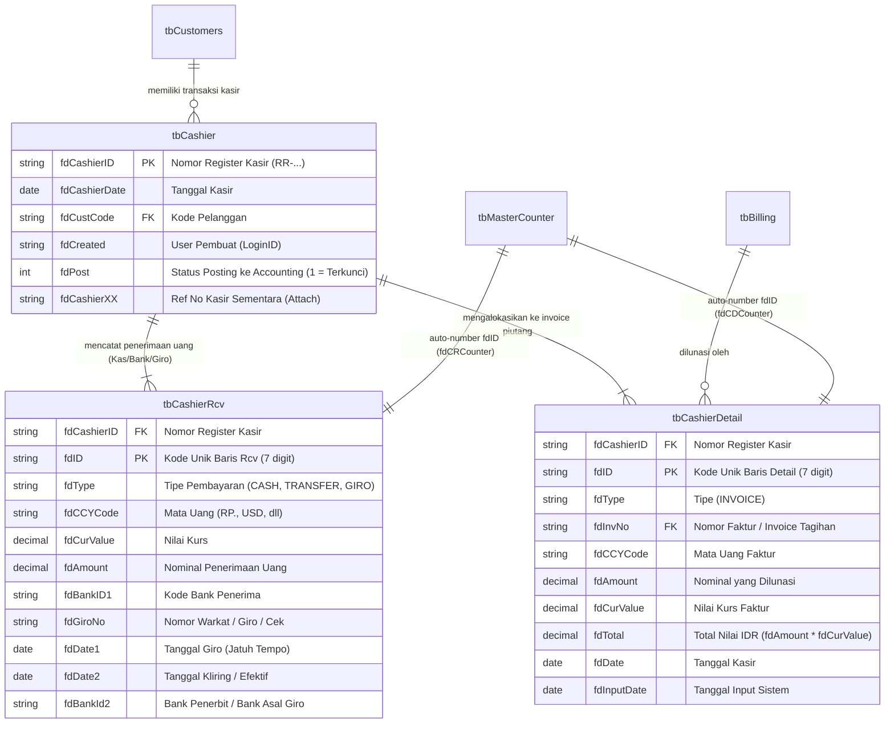
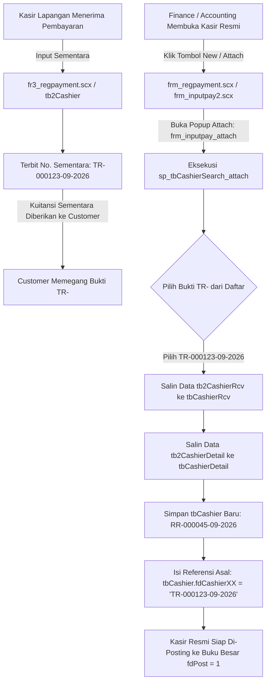
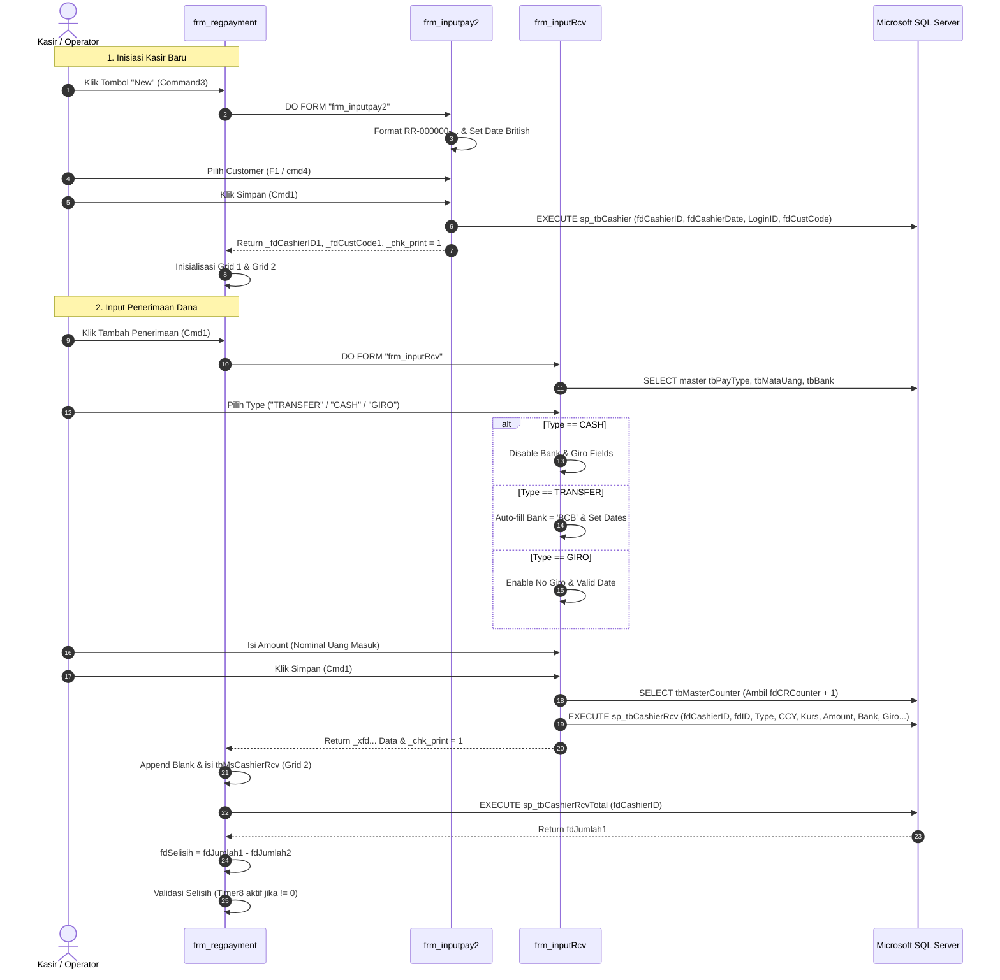

# 📘 Dokumentasi Teknis & Alur Bisnis: Pelunasan Pembayaran Piutang (Cashier Register)

Dokumen ini berisi dokumentasi komprehensif hasil analisis mendalam terhadap form Visual FoxPro:
1. **`c:\sejdb\sejdb2018\forms\frm_regpayment.scx`** (*Register Pembayaran Piutang - Form Utama*)
2. **`c:\sejdb\sejdb2018\forms\frm_inputpay2.scx`** (*Dialog Header & Pencarian Kasir*)
3. **`c:\sejdb\sejdb2018\forms\frm_inputRcv.scx`** (*Dialog Input Penerimaan Kas/Bank/Giro*)
beserta form pendukung lainnya, tabel database SQL Server, dan stored procedure yang terkait.

---

## 📌 1. Ringkasan Eksekutif

| Atribut | Keterangan |
|---|---|
| **Form Utama** | `frm_regpayment.scx` (Memo: `frm_regpayment.SCT`) |
| **Form Header / Lookup** | `frm_inputpay2.scx` (Memo: `frm_inputpay2.SCT`) |
| **Form Input Penerimaan**| `frm_inputRcv.scx` (Memo: `frm_inputRcv.SCT`) |
| **Judul Form Utama** | **Register Pembayaran Piutang** |
| **Fungsi Utama** | Registrasi bukti penerimaan uang (kas/bank/giro) dari pelanggan dan pengalokasian pelunasan terhadap faktur/invoice piutang (`tbBilling`). |
| **Format No. Registrasi** | `RR-XXXXXX-MM-YYYY` (Contoh: `RR-000001-01-2011`, reset setiap bulan) |
| **Penyimpanan Database** | Microsoft SQL Server (`tbCashier`, `tbCashierRcv`, `tbCashierDetail`, `tbMasterCounter`) |
| **Output Cetak** | Laporan Bukti Kasir via `rpf_cashier.frx` (`c:\sejdb\sejdb2018\Reports\rpf_cashier.frx`) |
| **Ekspor Berkas** | Format Microsoft Excel 5.0 (`FILE_CASHIER.XLS`) via view `Excel_tbCashierDetail` |

---

## 🏛️ 2. Arsitektur Struktur Data & Entitas Database

Modul pelunasan ini menggunakan 3 tabel transaksi inti pada SQL Server yang saling berelasi via kolom primary key `fdCashierID`:



### 2.1 Stored Procedure Terkait

1. **`sp_tbCashier`**: Menyimpan record header baru ke `tbCashier`.
   - Parameter: `@fdCashierID`, `@fdCashierDate`, `@LoginID`, `@fdCustCode`.
2. **`sp_tbCashierRcv`**: Menyimpan baris pembayaran uang ke `tbCashierRcv` (Grid 2).
   - Parameter: `@fdCashierID`, `@fdID`, `@fdType`, `@fdCCYCode`, `@fdCurValue`, `@fdAmount`, `@fdBankID1`, `@fdGiroNo`, `@fdDate1`, `@fdDate2`, `@fdBankId2`.
3. **`sp_tbCashierRcvTotal`**: Menghitung total nilai penerimaan kasir (`fdJumlah1`).
   - Query: Mengagregasi `SUM(fdAmount * fdCurValue)` dari `tbCashierRcv` untuk satu `fdCashierID`.
4. **`sp_tbCashierDetail` & `sp_tbCashierDetail_rev1`**: Menyimpan baris alokasi invoice (Grid 1).
   - Parameter: `@fdCashierID`, `@fdID`, `@fdType`, `@fdInvNo`, `@fdCCYCode`, `@fdAmount`, `@fdCurValue`, `@fdTotal`, `@fdDate`, `@fdInputDate`.
5. **`sp_tbCashierDetailTotal`**: Menghitung total alokasi pelunasan invoice (`fdJumlah2`).
   - Query: Mengagregasi `SUM(fdTotal)` dari `tbCashierDetail` untuk satu `fdCashierID`.
6. **`sp_tbBillingTotalView`**: Mengambil daftar invoice piutang yang belum lunas milik customer.
   - Parameter: `@fdCustCode`.
   - Menghasilkan daftar invoice dengan sisa tagihan: `(fdJumlah - fdbayar)`.
7. **`tbMasterCounter`**: Mengelola auto-number ID baris unik:
   - `fdCode = 'A'`
   - `fdCRCounter`: Counter baris `tbCashierRcv.fdID` (format: 7 digit numerik, misal `0000001`).
   - `fdCDCounter`: Counter baris `tbCashierDetail.fdID` (format: 7 digit numerik, misal `0000001`).

---

## 🖥️ 3. Analisis Form Utama: `frm_regpayment.scx`

Form ini bertindak sebagai orkestrator sentral proses pelunasan kasir:

```text
+---------------------------------------------------------------------------------------------------+
|  REGISTER PEMBAYARAN PIUTANG                                                            [_][X]   |
+---------------------------------------------------------------------------------------------------+
|  Tgl.        : [ fdCashierDate ]          Customer   : [ fdCustCode ] [ fdCustName              ] |
|  Cashier No. : [ fdCashierID   ]          Kasir Sem. : [ fdCashierID_Att ]                       |
+---------------------------------------------------------------------------------------------------+
|  [ GRID 2: DAFTAR PENERIMAAN UANG (KAS / BANK / GIRO) ]                         [+ Tambah (Cmd1)]  |
|  +------+------+------------+----------------+------+----------+------------+------------+---+---+ |
|  | Type | Curr | Curr Value | Amount         | Bank | Giro No. | Giro Date  | Valid Date | E | D | |
|  +------+------+------------+----------------+------+----------+------------+------------+---+---+ |
|  | CASH | RP.  | 1.00       | 5,000,000.00   |      |          |            |            |   |   | |
|  | TRF  | RP.  | 1.00       | 10,000,000.00  | BCB  |          | 17/09/2026 | 17/09/2026 |   |   | |
|  +------+------+------------+----------------+------+----------+------------+------------+---+---+ |
|  Total Penerimaan (fdJumlah1): Rp. 15,000,000.00                                                  |
+---------------------------------------------------------------------------------------------------+
|  [ GRID 1: ALOKASI PELUNASAN INVOICE / PIUTANG ]               [+ Check Billing (Cmd3)] [Manual] |
|  +---------+--------------------+------+---------------+------------+---------------+---+---+----+|
|  | Type    | Billing/Invoice No | Cur  | Amount        | Curr Value | Total         | E | D | AJ ||
|  +---------+--------------------+------+---------------+------------+---------------+---+---+----+|
|  | INVOICE | 26010045           | RP.  | 5,000,000.00  | 1.00       | 5,000,000.00  |   |   |    ||
|  | INVOICE | 26010098           | RP.  | 10,000,000.00 | 1.00       | 10,000,000.00 |   |   |    ||
|  +---------+--------------------+------+---------------+------------+---------------+---+---+----+|
|  Total Alokasi (fdJumlah2):    Rp. 15,000,000.00                                                  |
+---------------------------------------------------------------------------------------------------+
|  SELISIH (fdSelisih = fdJumlah1 - fdJumlah2): Rp. 0.00  <-- [Timer8 Berkedip jika <> 0]           |
+---------------------------------------------------------------------------------------------------+
|  [ New (Command3) ]  [ Find (Command2) ]  [ Delete (Command1) ]  [ Print (Command4) ]             |
|  [ Attach Sem. (Command5) ]  [ Export Excel (Command6) ]                                          |
+---------------------------------------------------------------------------------------------------+
```

### 3.1 Kontrol Header Form
- **`fdCashierDate` (Textbox)**: Tanggal transaksi kasir (format British/DMY).
- **`fdCashierID` (Textbox)**: Nomor kasir unik (`RR-xxxxxx-...`).
- **`fdCustCode` (Textbox)**: Kode pelanggan. KeyCode 28 (F1) membuka popup pencarian pelanggan `frm_Customerslist`.
- **`fdCustName` (Textbox)**: Nama pelanggan resmi dari master `tbCustomers.fdCustName`.
- **`fdCashierID_Att` (Textbox)**: Nomor register kasir sementara (dari kolom `tbCashier.fdCashierXX`).
- **`fdJumlah1` (Textbox)**: Total penerimaan uang dari Grid 2 (`sp_tbCashierRcvTotal`).
- **`fdJumlah2` (Textbox)**: Total alokasi faktur dari Grid 1 (`sp_tbCashierDetailTotal`).
- **`fdSelisih` (Textbox)**: Selisih `fdJumlah1 - fdJumlah2`.

### 3.2 Grid 2 — Rincian Penerimaan Kas/Bank/Giro (`tbMsCashierRcv`)
RecordSource: `tbmscashierrcv` (data dari `tbCashierRcv`).
- **Kolom**: `Type`, `Curr`, `Curr Value`, `Amount`, `Bank`, `Giro No.`, `Giro Date`, `Valid Date`, `Bank 2`.
- **Tombol Aksi**:
  - `Cmd1` (Tambah Baris): Memanggil dialog **`frm_inputRcv.scx`**.
  - `Column10.Command1` (**E** / Edit): Membuka `frm_inputRcv2.scx`.
  - `Column11.Command1` (**D** / Delete): Menghapus baris dari `tbCashierRcv` via query `DELETE tbCashierRcv WHERE fdID = '<fdID>'` lalu menghitung ulang total `sp_tbCashierRcvTotal`.

### 3.3 Grid 1 — Rincian Alokasi Invoice Piutang (`tbMsCashierDetail`)
RecordSource: `tbmscashierdetail` (data dari `tbCashierDetail`).
- **Kolom**: `Type`, `Billing/Invoice No.` (`fdInvNo`), `Cur`, `Amount`, `Curr Value`, `Total`.
- **Tombol Aksi**:
  - `Cmd3` (**Check Billing**): Memanggil **`frm_checkBilling.scx`** untuk menarik faktur belum lunas dari `sp_tbBillingTotalView`.
  - `cmd2` (**Manual Detail**): Membuka `frm_inputDtl.scx` untuk input alokasi faktur manual.
  - `Column7.Command1` (**E** / Edit): Membuka `frm_inputDtl2.scx`.
  - `Column8.Command1` (**D** / Delete): Menghapus baris via `DELETE tbCashierDetail WHERE fdID = '<fdID>'` lalu hitung ulang `sp_tbCashierDetailTotal`.
  - `Column9.Command1` (**AJ** / Billing Adjustment): Membuka `frm_Billing2.scx` (hanya aktif jika otorisasi finance `_tag43 == 1`).

---

## 🔍 4. Analisis Mendalam: `frm_inputpay2.scx` (Dialog Header & Pencarian Kasir)

Form `frm_inputpay2.scx` adalah dialog modal berukuran 460x175 px yang memiliki peran ganda (*dual-purpose*) dalam siklus transaksi kasir:
1. **Mode Create (Saat dipanggil dari tombol `New` / `Command3`)**: Menentukan nomor register kasir baru, tanggal, dan memilih pelanggan yang akan dilunasi.
2. **Mode Search / Lookup (Saat dipanggil dari tombol `Find` / `Command2`)**: Mencari transaksi kasir yang sudah ada di database untuk ditampilkan kembali atau diedit.

```text
+---------------------------------------------------------------------+
|  Input Payment / Cashier Header                             [_][X]  |
+---------------------------------------------------------------------+
|  Customer     : [ fdCustCode ] [...] [ fdCustName                 ] |
|  Cashier Date : [ fdCashierDate ]                                   |
|  Cashier No.  : [ fdCashierID   ] [...]                             |
+---------------------------------------------------------------------+
|                                            [ OK (v) ]  [ Batal (x) ]|
+---------------------------------------------------------------------+
```

### 4.1 Inventaris Kontrol & Properti (`frm_inputpay2.scx`)

| Nama Objek | BaseClass | TabIndex | Format / Mask | Deskripsi & Event Penting |
|---|---|---|---|---|
| `Form1` | `form` | - | - | WindowType: 1 (Modal), BackColor: `RGB(240,240,240)` |
| `fdCustCode` | `textbox` | 1 | `!K` / `XXXXXXX` | Input kode pelanggan. Max 7 karakter huruf kapital. |
| `cmd4` | `commandbutton` | 10 | Caption: `...` | Tombol popup pencarian pelanggan by name (`_keyID = 3`). |
| `fdCustName` | `textbox` | 2 | `!K` | Tampilan nama pelanggan. Mendukung lookup popup (`_keyID = 3`). |
| `fdCashierDate` | `textbox` | 3 | Format: `R` | Input tanggal transaksi kasir. Default tanggal hari ini (`DATE()`). |
| `fdCashierID` | `textbox` | 4 | `!K` | Nomor register kasir (`RR-xxxxxx-...`). |
| `cmd3` | `commandbutton` | 11 | Caption: `...` | Tombol lookup daftar kasir via `frm_inputpaylist.scx`. |
| `Cmd1` | `commandbutton` | 5 | Picture: `vok.bmp` | Tombol Simpan/Konfirmasi (Eksekusi `sp_tbCashier` / Cek `fdPost`). |
| `Cmd2` | `commandbutton` | 6 | Picture: `vdcancel.bmp` | Tombol Batal/Cancel (`_chk_print = 0`, Release). |

### 4.2 Logika Inisialisasi & Auto-Numbering Format `RR-` (`PROCEDURE Init`)
Saat form `frm_inputpay2` diinisialisasi:
```foxpro
PROCEDURE Init
SET DATE BRITISH
PUBLIC _fdCustCode, _fdCustName, _fdCashierID1, _keymode
PUBLIC _fdCashierDate1, _fdCustCode1, _fdCustName1

_execute = 0

* Logika Penomoran Kasir Otomatis:
IF _CounterReg = 0 THEN
    THISFORM.fdCashierID.VALUE = 'RR-000000-00-0000'
ELSE
    THISFORM.fdCashierID.VALUE = 'RR-' + RIGHT('000000' + ALLTRIM(STR(_CounterReg + 1)), 6) + _StrKanan
ENDIF

THISFORM.fdCashierDate.VALUE = _tgldefault
ENDPROC
```
- Variabel global `_CounterReg` mencatat angka counter 6-digit kasir terakhir pada bulan berjalan.
- Variabel `_StrKanan` menyimpan suffix `-MM-YYYY` (misal `-01-2011` atau `-09-2026`).
- **Format Resmi**: `RR-XXXXXX-MM-YYYY` (contoh: `RR-000001-01-2011`), di mana sequence 6-digit di-reset kembali ke `000001` setiap awal bulan baru.


### 4.3 Logika Validasi Pelanggan (`fdCustCode` & `fdCustName`)
1. **Pencarian via KeyPress F1 (KeyCode 28) atau Tombol `cmd4` (`...`)**:
   - Menyetel mode pencarian: `_keyID = 2` (search by code) atau `_keyID = 3` (search by name).
   - Membuka form popup: `DO FORM frm_customerslist1_rev1`.
   - Mengambil nilai return `_fdCustCode` dan memanggil event `Valid()`.
2. **Event `Valid` pada `fdCustCode`**:
   ```foxpro
   PROCEDURE Valid
   IF !EMPTY(this.Value) THEN
       uSQLString = "SELECT * FROM tbCustomers WHERE fdCustCode = '" + ALLTRIM(this.value) + "'"
       SQLEXEC (strConnHandle, uSQLString, "tbCustomers")
       IF !EMPTY(fdCustCode) THEN
           thisform.fdCustCode.value = fdCustCode
           thisform.fdCustName.value = PutComma(fdCustName)
           thisform.Refresh()
       ELSE
           MESSAGEBOX("Data Customers Not Found ! ", 64, "Readme")
       ENDIF
   ENDIF
   ENDPROC
   ```
   - *Penting*: Nama pelanggan selalu diformat menggunakan fungsi `PutComma(fdCustName)`.

### 4.4 Logika Validasi Kasir Existing (`fdCashierID.Valid`)
Jika user memasukkan nomor kasir yang sudah pernah ada:
```foxpro
PROCEDURE Valid
IF !EMPTY(this.Value) THEN
    uSQLString = "SELECT * FROM tbCashier WHERE fdCashierID = '" + ALLTRIM(thisform.fdCashierID.value) + "'"
    SQLEXEC (strConnHandle, uSQLString, "tbCashier")
    IF !EMPTY(fdCashierID) THEN
        thisform.fdCashierID.value = fdCashierID
        thisform.fdCashierDate.value = ctod(dtoc(fdCashierDate))
        thisform.fdCustCode.value = fdCustCode
        thisform.fdCustCode.valid()
        thisform.Refresh()
    ENDIF
ENDIF
ENDPROC
```

### 4.5 Logika Eksekusi Tombol Simpan (`Cmd1.Click`)
```foxpro
PROCEDURE Click
IF EMPTY(thisform.fdCustCode.value) THEN
    RETURN
ENDIF 

IF !EMPTY(thisform.fdCashierID.Value) THEN
    uSQLString = "SELECT * FROM tbCashier WHERE fdCashierID = '" + ALLTRIM(thisform.fdCashierID.value) + "'"
    SQLEXEC (strConnHandle, uSQLString, "tbCashier")
    
    * KASUS A: KASIR BARU (BELUM ADA DI DATABASE)
    IF RECCOUNT() = 0 THEN
        SET DATE TO MDY
        _fdCashierID   = "'" + ALLTRIM(thisform.fdCashierID.value) + "',"
        _fdCashierID1  = "'" + ALLTRIM(thisform.fdCashierID.value) + "'"
        _fdCashierDate = "'" + ALLTR(DTOC(thisform.fdCashierDate.value)) + "',"
        _fdCustCode    = "'" + ALLTR(thisform.fdCustCode.value) + "'"
            
        uSQLString = _fdCashierID + _fdCashierDate + "'" + _LoginID + "'," + _fdCustCode
        uSQLString = "Execute sp_tbCashier " + uSQLString
        SQLEXEC (strConnHandle, uSQLString, "RecordStatus")

        _fdCashierDate1 = thisform.fdCashierDate.value
        _fdCustCode1    = thisform.fdCustCode.value
        _fdCustName1    = thisform.fdCustName.value
    
    * KASUS B: KASIR SUDAH ADA (EXISTING)
    ELSE 
        IF fdpost = 1 THEN 
            IF MessageBox("Kode Cashier Sudah Di Posting Ke Accounting, Lihat Detail  ?   ", 32 + 4, "Perhatian") = 7
                RETURN 
            ENDIF
            _fdCashierID1   = ALLTRIM(thisform.fdCashierID.value) 
            _fdCashierDate1 = thisform.fdCashierDate.value
            _fdCustCode1    = thisform.fdCustCode.value
            _fdCustName1    = thisform.fdCustName.value
            DO FORM "frm_view_billing"
            RETURN 
        ENDIF 
    ENDIF
ENDIF    

* Simpan state sesi terakhir untuk penomoran otomatis berikutnya:
SET DATE TO MDY
_fdCashierID1   = thisform.fdCashierID.value
_fdCashierDate1 = thisform.fdCashierDate.value
_fdCustCode1    = thisform.fdCustCode.value
_fdCustName1    = thisform.fdCustName.value
_tgldefault     = thisform.fdCashierDate.value
_CounterReg     = VAL(SUBSTR(thisform.fdCashierID.value, 4, 6))
_StrKanan       = RIGHT(ALLTRIM(thisform.fdCashierID.value), 8)

_chk_print = 1
SET DATE TO DMY	
RELEASE THISFORM
ENDPROC
```

---

## 💵 5. Analisis Mendalam: `frm_inputRcv.scx` (Dialog Input Penerimaan Kas/Bank/Giro)

Form `frm_inputRcv.scx` adalah dialog modal berukuran 510x205 px yang dipanggil dari tombol **`Cmd1`** pada form utama `frm_regpayment`. Fungsinya adalah menambahkan baris baru pada **Grid 2** (`tbCashierRcv`) untuk mencatat uang masuk.

```text
+------------------------------------------------------------------------------+
|  Input Payment Received                                             [_][X]   |
+------------------------------------------------------------------------------+
|  Cashier No. : [ fdCashierID (Disabled) ]                                    |
|  Type        : [ fdType (Combo) ]        Curr: [ fdCCYCode ] Kurs: [ fdCurr] |
|  Amount      : [ fdAmount ]                                                  |
|  Bank/Giro   : [ fdBankID1 (Combo) ] [ fdGiroNo          ] [ fdGiroDate    ] |
|  Valid Date  : [ fdValidDate       ] [ fdBankID2 (Combo) ]                   |
+------------------------------------------------------------------------------+
|                                                    [ OK (v) ]  [ Batal (x) ] |
+------------------------------------------------------------------------------+
```

### 5.1 Inventaris Kontrol & Properti (`frm_inputRcv.scx`)

| Nama Objek | BaseClass | TabIndex | Format / Mask / RowSource | Deskripsi & Validasi |
|---|---|---|---|---|
| `Form1` | `form` | - | - | WindowType: 1 (Modal), BackColor: `RGB(240,240,240)` |
| `fdCashierID` | `textbox` | 1 | `!K`, `Enabled = .F.` | Nomor kasir dari form pemanggil (`_fdCashierID1`). Terkunci. |
| `fdType` | `combobox` | 2 | RowSource: `tbPayType` | Tipe pembayaran (`CASH`, `TRANSFER`, `GIRO`, `CASH BACK`, dll). |
| `fdCCYCode` | `combobox` | 3 | RowSource: `tbMataUang.fdCCYCode` | Kode mata uang tagihan. Default: `'RP.'`. |
| `fdCurrValue` | `textbox` | 4 | Numerik | Nilai kurs mata uang terhadap Rupiah. Default: `1.00`. |
| `fdAmount` | `textbox` | 5 | `K` / `99,999,999,999.99` | Nominal uang riil yang diterima. |
| `fdBankID1` | `combobox` | 6 | RowSource: `tbBank.fdBankCode` | Akun bank penerima perusahaan (e.g. `BCB` untuk BCA). |
| `fdGiroNo` | `textbox` | 7 | `!K` | Nomor warkat cek atau bilyet giro. |
| `fdGiroDate` | `textbox` | 8 | Date | Tanggal warkat / jatuh tempo giro (`fdDate1`). |
| `fdValidDate` | `textbox` | 9 | `!K` / `XXXXXXXXXX` | Tanggal efektif kliring / pencairan dana (`fdDate2`). |
| `fdBankID2` | `combobox` | 10 | RowSource: `tbBank.fdBankCode` | Bank penerbit warkat giro / asal transfer. |
| `Cmd1` | `commandbutton` | 11 | Picture: `vok.bmp` | Tombol Simpan baris penerimaan (`sp_tbCashierRcv`). |
| `Cmd2` | `commandbutton` | 21 | Picture: `vdcancel.bmp` | Tombol Batal/Cancel (`_chk_print = 0`, Release). |

### 5.2 Inisialisasi Kursor & Master Data (`PROCEDURE Load` & `Init`)
Saat form dibuka:
```foxpro
PROCEDURE Load
Select 1
SQLEXEC (strConnHandle, "select * from tbMataUang", "tbMataUang")
Select 2
SQLEXEC (strConnHandle, "select * from tbPayType", "tbPayType")
Select 3
SQLEXEC (strConnHandle, "select * from tbBank", "tbBank")
ENDPROC

PROCEDURE Init
this.fdCashierID.value  = _fdCashierID1
this.fdType.value       = ''
this.fdCCYCode.value    = 'RP.'
this.fdCurrValue.value  = 1
this.fdAmount.value     = 0
this.fdBankID1.value    = ''
this.fdGiroNo.value     = ''
this.fdGiroDate.value   = {  /  /    }
this.fdValidDate.value  = {  /  /    }
this.fdBankID2.value    = ''
ENDPROC
```

### 5.3 Logika Kondisional Dinamis Tipe Pembayaran (`fdType.InteractiveChange`)
Event ini mengatur perilaku form berdasarkan instrumen pembayaran yang dipilih kasir:
```foxpro
PROCEDURE InteractiveChange
* KASUS 1: TUNAI / CASH
IF THIS.VALUE = "CASH" AND THIS.VALUE != "CASH BACK" THEN
    THISFORM.fdBankID1.VALUE   = ''
    THISFORM.fdGiroNo.VALUE    = ''
    THISFORM.fdGiroDate.VALUE  = {  /  /    }
    THISFORM.fdValidDate.VALUE = {  /  /    }
    THISFORM.fdBankID2.VALUE   = ''
    
    * Nonaktifkan seluruh input warkat/bank:
    THISFORM.fdBankID1.ENABLED   = .F.
    THISFORM.fdGiroNo.ENABLED    = .F.
    THISFORM.fdGiroDate.ENABLED  = .F.
    THISFORM.fdValidDate.ENABLED = .F.
    THISFORM.fdBankID2.ENABLED   = .F.

* KASUS 2: TRANSFER BANK ATAU GIRO
ELSE
    * Jika TRANSFER, set nilai default bank BCA dan tanggal kasir saat ini:
    IF ALLTRIM(THIS.VALUE) = 'TRANSFER'
        THISFORM.fdBankID1.VALUE   = 'BCB'
        THISFORM.fdBankID2.VALUE   = 'BCB'
        THISFORM.fdGiroDate.VALUE  = _fdCDate
        THISFORM.fdValidDate.VALUE = _fdCDate
    ENDIF
    
    * Aktifkan seluruh input bank dan tanggal warkat:
    THISFORM.fdBankID1.ENABLED   = .T.
    THISFORM.fdGiroNo.ENABLED    = .T.
    THISFORM.fdGiroDate.ENABLED  = .T.
    THISFORM.fdValidDate.ENABLED = .T.
    THISFORM.fdBankID2.ENABLED   = .T.
ENDIF
ENDPROC
```

### 5.4 Auto-Sync Nilai Kurs Mata Uang (`fdCCYCode.InteractiveChange`)
Saat mata uang diubah (misal dari `RP.` ke `USD`):
```foxpro
PROCEDURE InteractiveChange
SELECT tbMataUang
thisform.fdCurrValue.Value = fdCCYValue
ENDPROC
```

### 5.5 Eksekusi Simpan Baris Penerimaan (`Cmd1.Click`)
1. Mengambil nomor ID baris unik 7-digit berikutnya dari counter `fdCRCounter`:
   ```foxpro
   uSQLString = "Select * from tbMasterCounter where fdCode = 'A'"
   SQLEXEC (strConnHandle, uSQLString, "TableCounter")
   _xfdID = RIGHT("000000" + ALLTR(STR(fdCRCounter + 1)), 7)
   ```
2. Membentuk dan mengeksekusi Stored Procedure **`sp_tbCashierRcv`**:
   ```foxpro
   SET DATE TO MDY
   uSQLString = _fdCashierID + _fdID + _fdType + _fdCCYCode + _fdCurrValue + _fdAmount + _fdBankID1 + ;
                _fdGiroNo + _fdGiroDate + _fdValidDate + _fdBankID2
   uSQLString = "Execute sp_tbCashierRcv " + uSQLString
   SQLEXEC (strConnHandle, uSQLString, "RecordStatus")
   SET DATE TO DMY
   ```
3. Mengembalikan data baris baru ke form pemanggil `frm_regpayment` melalui variabel publik `_xfd...` dan `_chk_print = 1`.
4. Form pemanggil memasukkan baris tersebut ke `tbMsCashierRcv`, me-refresh Grid 2, dan memanggil `sp_tbCashierRcvTotal` untuk menghitung ulang `fdJumlah1` dan `fdSelisih`.

---

## 🕒 6. Analisis Lengkap Modul Pembayaran Sementara: `fr3_regpayment.scx` (`TR-` Series)

Form **`c:\sejdb\sejdb2018\forms\fr3_regpayment.scx`** adalah modul **Input Pembayaran Sementara** (*Temporary Payment Register / Bukti Kas Masuk Sementara*). Modul ini digunakan saat kasir atau petugas lapangan menerima uang muka / titipan / pembayaran dari pelanggan yang belum dapat dibukukan secara permanen sebagai kasir resmi (`RR-`), melainkan dicatat terlebih dahulu sebagai bukti kasir sementara dengan nomor register ber-prefix **`TR-`**.

### 6.1 Identitas & Arsitektur Form `fr3_regpayment.scx`

| Atribut | Detail |
|---|---|
| **Berkas SCX & SCT** | `c:\sejdb\sejdb2018\forms\fr3_regpayment.scx` (Memo SCT: 58.411 bytes) |
| **Class & BaseClass** | `frmregpayment` (Base: `form`), didampingi 70 sub-komponen kontrol UI |
| **Caption Form** | **Register Pembayaran Piutang (Sementara)** |
| **Format No. Kasir** | **`TR-XXXXXX-MM-YYYY`** (Contoh: `TR-000001-09-2026`) |
| **Tabel Database Utama** | **`tb2Cashier`**, **`tb2CashierRcv`**, **`tb2CashierDetail`** |
| **Counter Sequence** | **`tbMasterCounter` dengan kode `fdCode = 'B'`** (`fdCRCounter` & `fdCDCounter`) |
| **Form Pendamping Ekosistem `fr3_`** | `fr3_inputpay2.scx`, `fr3_inputrcv.scx`, `fr3_inputrcv2.scx`, `fr3_inputdtl.scx`, `fr3_inputdtl2.scx`, `fr3_checkbilling.scx`, `fr3_view_billing.scx` |

### 6.2 Perbedaan Kunci: Kasir Sementara (`fr3_`) vs Kasir Resmi (`frm_`)

| Parameter | Kasir Resmi (`frm_regpayment.scx`) | Kasir Sementara (`fr3_regpayment.scx`) |
|---|---|---|
| **Prefix Penomoran** | **`RR-`** (Official Receipt Register) | **`TR-`** (Temporary Receipt Register) |
| **Tabel Header** | `tbCashier` | `tb2Cashier` |
| **Tabel Penerimaan Uang** | `tbCashierRcv` | `tb2CashierRcv` |
| **Tabel Alokasi Faktur** | `tbCashierDetail` | `tb2CashierDetail` |
| **Counter Master** | `tbMasterCounter` where **`fdCode = 'A'`** | `tbMasterCounter` where **`fdCode = 'B'`** |
| **Stored Procedure Header** | `sp_tbCashier` | `sp_tb3Cashier` |
| **Stored Procedure Total Rcv** | `sp_tbCashierRcvTotal` | `sp_tb2CashierRcvTotal` |
| **Stored Procedure Total Detail** | `sp_tbCashierDetailTotal` | `sp_tb2CashierDetailTotal` |
| **Stored Procedure Query Unpaid** | `sp_tbBillingTotalView` | `sp_tb2BillingTotalView` |
| **Efek Akuntansi / GL** | Dapat di-posting ke Buku Besar (`fdPost = 1`) | Staging buffer, **belum masuk pembukuan final** |
| **Hubungan Relasi** | Mengonsumsi data kasir sementara via kolom `tbCashier.fdCashierXX` | Sumber data yang akan di-attach ke kasir resmi |

### 6.3 Bedah Kontrol UI & Logika Form `fr3_regpayment.scx`

1. **Header Form**:
   - `fdCashierID`: Menampilkan nomor kasir sementara aktif (`TR-000001-09-2026`).
   - `fdCashierDate`: Tanggal penerimaan sementara.
   - `fdCustCode` & `fdCustName`: Kode dan nama pelanggan (divalidasi ke master `tbCustomers`).
   - `text3`: Keterangan / memo kasir sementara (diperbarui via `frm_description`).
2. **Tabel Grid 2 (`tbMsCashierRcv` -> `tb2CashierRcv`)**:
   - Mengelola rincian uang kas/bank/giro yang diterima sementara.
   - Kolom `E` (`Command1`): Membuka form edit `fr3_inputRcv2`, lalu menghitung ulang `sp_tb2CashierRcvTotal`.
   - Kolom `D` (`Command1`): Konfirmasi hapus baris `DELETE FROM tb2CashierRcv WHERE fdID = _fdID`, lalu hitung ulang total via `sp_tb2CashierRcvTotal`.
3. **Tabel Grid 1 (`tbMsCashierDetail` -> `tb2CashierDetail`)**:
   - Mengelola alokasi sementara terhadap tagihan invoice (`tbBilling`).
   - Kolom `E` (`Command1`): Membuka dialog edit alokasi `fr3_inputDtl2`, lalu kalkulasi `sp_tb2CashierDetailTotal`.
   - Kolom `D` (`Command1`): Konfirmasi hapus baris alokasi `DELETE FROM tb2CashierDetail WHERE fdID = _fdID`.
4. **Tombol Aksi Bawah**:
   - `cmd1` (Tambah Penerimaan): Membuka dialog `fr3_inputrcv` untuk menambah kas/transfer/giro sementara.
   - `cmd2` (Tambah Alokasi Manual): Membuka dialog `fr3_inputdtl`.
   - `Cmd3` (Pilih Faktur Belum Lunas): Membuka dialog checklist `fr3_checkbilling` yang memanggil `sp_tb2BillingTotalView`.
   - `Command1` (Delete Kasir Sementara): Konfirmasi hapus seluruh data transaksi sementara:
     ```sql
     DELETE FROM tb2Cashier WHERE fdCashierID = 'TR-XXXXXX-MM-YYYY'
     ```
   - `Command2` (Find / Cari Kasir Sementara): Membuka `fr3_inputpay2` untuk mencari transaksi `TR-` yang sudah ada, lalu mengisi kursor `tb2CashierRcv` dan `tb2CashierDetail`.
   - `Command3` (New / Buat Baru): Membuka `fr3_inputpay2` dengan nomor berikutnya `TR-XXXXXX-...`.
   - `Command5` (Keterangan): Membuka modal `frm_description` dan mengupdate `tb2Cashier.fdDescr`.

---

## 🔗 7. Mekanisme Proses "Attach" (Konversi Sementara `TR-` ke Resmi `RR-`)

Salah satu fitur paling krusial dalam siklus hidup pembayaran piutang adalah proses **Attach / Penggabungan** dari Bukti Pembayaran Sementara (`TR-`) menjadi Bukti Pembayaran Resmi (`RR-`).

### 7.1 Alur Kerja Bisnis Proses Attach



### 7.2 Bedah Teknis Dialog `frm_inputpay_attach.scx`
- Form ini berbasis `FRM_CITYLIST` dengan judul *"Data List / Attach Invoice from List"*.
- Pada event `Load`, form mengeksekusi stored procedure pencarian kasir sementara:
  ```sql
  EXECUTE sp_tbCashierSearch_attach '_StrCommand'
  ```
- Menampilkan daftar transaksi kasir sementara (`tb2Cashier`) yang belum di-attach, lengkap dengan nama customer dan total uang.
- Saat user menekan Enter atau Double Click pada baris data list:
  ```foxpro
  _fdCustName = fdCustName
  _fdCashierID_Attach = fdCashierID   && Menyimpan nomor TR-... yang dipilih
  RELEASE thisform
  ```
- Form pemanggil `frm_regpayment` kemudian mencatat nomor tersebut ke kolom `THISFORM.fdCashierID_Att.VALUE = _fdCashierID_Attach` dan memasukkan relasi ke `tbCashier.fdCashierXX`.

---

## 🔄 8. Diagram Alur Interaksi Form (Sequence Diagram)

Berikut adalah diagram urutan interaksi data antara form utama `frm_regpayment`, dialog `frm_inputpay2`, dialog `frm_inputRcv`, dan SQL Server:



---

## 🗂️ 9. Ringkasan Hubungan Form & Stored Procedure

| Form FoxPro | Trigger / Caller | Aksi Database & Stored Procedure | Keterangan |
|---|---|---|---|
| **`frm_regpayment.scx`** | Menu Utama Aplikasi | `sp_tbCashierRcvTotal`, `sp_tbCashierDetailTotal`, `DELETE tbCashier` | Form orkestrator utama kasir resmi (`RR-`) |
| **`fr3_regpayment.scx`** | Menu Pembayaran Sementara | `sp_tb2CashierRcvTotal`, `sp_tb2CashierDetailTotal`, `DELETE tb2Cashier` | Form orkestrator utama kasir sementara (`TR-`) |
| **`frm_inputpay2.scx`** | Tombol `New` & `Find` pada `frm_regpayment` | `sp_tbCashier`, `SELECT FROM tbCustomers`, `SELECT FROM tbCashier` | Validasi customer, nomor kasir resmi `RR-`, dan cek status `fdPost` |
| **`fr3_inputpay2.scx`** | Tombol `New` & `Find` pada `fr3_regpayment` | `sp_tb3Cashier`, `SELECT FROM tbCustomers`, `SELECT FROM tb2Cashier` | Validasi customer dan generate nomor kasir sementara `TR-` |
| **`frm_inputRcv.scx`** | Tombol `Cmd1` pada `frm_regpayment` | `sp_tbCashierRcv`, `SELECT FROM tbMasterCounter` (`fdCode='A'`, `fdCRCounter`) | Input penerimaan kas/bank/giro kasir resmi |
| **`fr3_inputrcv.scx`** | Tombol `cmd1` pada `fr3_regpayment` | `INSERT tb2CashierRcv`, `SELECT FROM tbMasterCounter` (`fdCode='B'`, `fdCRCounter`) | Input penerimaan kas/bank/giro kasir sementara |
| **`frm_checkBilling.scx`**| Tombol `Cmd3` pada `frm_regpayment` | `sp_tbBillingTotalView`, `sp_tbCashierDetail_rev1` | Tarik daftar faktur belum lunas ke kasir resmi |
| **`fr3_checkbilling.scx`**| Tombol `Cmd3` pada `fr3_regpayment` | `sp_tb2BillingTotalView`, `INSERT tb2CashierDetail` | Tarik daftar faktur belum lunas ke kasir sementara |
| **`frm_inputpay_attach.scx`**| Tombol Attach pada `frm_regpayment` | `sp_tbCashierSearch_attach`, salin data `tb2Cashier*` $\to$ `tbCashier*` | Menghubungkan kasir sementara ke kasir resmi |
| **`frm_view_billing.scx`**| Dipicu saat kasir resmi `fdPost = 1` | Mode read-only | Proteksi transaksi yang sudah diposting ke GL |
| **`fr3_view_billing.scx`**| Dipicu saat kasir sementara `fdPost = 1` | Mode read-only | Proteksi transaksi sementara yang sudah diproses |

---

## 🚀 10. Rekomendasi Arsitektur Web ERP Modern mshipping

Berdasarkan bedah tuntas form resmi (`frm_`) dan form pembayaran sementara (`fr3_`), berikut adalah arsitektur rekomendasi untuk migrasi ke sistem web mshipping:

### 10.1 Modul Backend (`backend/src/modules/billing/` atau `cashier/`)
1. **Endpoint Registrasi Kasir Resmi (`RR-`) & Sementara (`TR-`)**:
   - `POST /api/cashier`: Pembuatan kasir resmi (`type: 'OFFICIAL'`), format nomor `RR-000001-MM-YYYY` (reset sequence setiap bulan), simpan ke `tbCashier`.
   - `POST /api/cashier/temp`: Pembuatan kasir sementara (`type: 'TEMPORARY'`), format nomor `TR-000001-MM-YYYY` (counter `fdCode='B'`), simpan ke `tb2Cashier`.
   - `POST /api/cashier/attach`: Konversi kasir sementara ke kasir resmi. Menyalin seluruh item dari `tb2CashierRcv` & `tb2CashierDetail` ke `tbCashierRcv` & `tbCashierDetail`, mengupdate `tbCashier.fdCashierXX = tempCashierId`.
2. **Endpoint Penerimaan Pembayaran (`tbCashierRcv` & `tb2CashierRcv`)**:
   - `POST /api/cashier/:id/rcv`: Validasi `fdType`. Jika `TRANSFER`, enforce rekening bank. Jika `GIRO`, enforce tanggal jatuh tempo & bank tertarik.
   - `DELETE /api/cashier/:id/rcv/:rcvId`: Hapus baris penerimaan dan kalkulasi ulang saldo selisih.
3. **Endpoint Alokasi Faktur (`tbCashierDetail` & `tb2CashierDetail`)**:
   - `GET /api/cashier/unpaid/:custCode`: Mengambil tagihan faktur yang belum lunas (`fdJumlah - fdbayar > 0`).
   - `POST /api/cashier/:id/allocate`: Batch insert alokasi faktur dan update saldo piutang.

### 10.2 Komponen Frontend Web (`frontend/src/features/cashier/`)
1. **Daftar Meja Kasir (`ListPage.tsx`)**:
   - Segmented Tab: **"Kasir Resmi (RR)"** vs **"Pembayaran Sementara (TR)"**.
   - Kolom tabel: Nomor Kasir, Tanggal, Customer (Single Source of Truth `tbCustomers.fdCustName`), Total Uang Masuk, Total Alokasi Faktur, Status Selisih, Ref Kasir Sementara (`fdCashierXX`), Status Posting.
2. **Modal Attach Kasir Sementara (`AttachTempReceiptModal.tsx`)**:
   - Muncul saat kasir membuat tanda terima resmi baru dan memilih opsi *"Tarik dari Pembayaran Sementara"*.
   - Menampilkan listbox pencarian pembayaran sementara (`TR-`) yang masih pending.
3. **Indikator Keseimbangan (Zero-Difference Balance Badge)**:
   - Sesuai standar desain Midnight Dark Mode:
     - Jika `selisih === 0`: Badge hijau transparan `border border-emerald-500/40 text-emerald-400 bg-transparent` bertuliskan **`SEIMBANG (Rp 0)`**.
     - Jika `selisih !== 0`: Banner peringatan rose `border border-rose-500/40 text-rose-400 bg-rose-500/10 animate-pulse` bertuliskan **`SELISIH: Rp. X,XXX,XXX.XX`**.

---

## 📝 11. Catatan Kepatuhan Aturan Agen (Compliance Notes)
- **Single Source of Truth Pelanggan**: Sesuai aturan wajib `.agents/AGENTS.md`, seluruh penyajian data nama pelanggan pada modul kasir/pelunasan ini **WAJIB SELALU mengacu pada data master `tbCustomers.fdCustName`**.
- **Penomoran Reset Bulanan**: Format resmi kasir resmi `RR-000001-MM-YYYY` dan kasir sementara `TR-000001-MM-YYYY` dengan sequence 6-digit yang wajib di-reset ke `000001` setiap tanggal 1 awal bulan baru.
- **Dark Mode Compliance**: Tidak menggunakan background putih terang (`bg-white`) pada tombol atau badge aktif.
- **Multibahasa (i18n)**: Seluruh string teks visual (label, status, pesan peringatan selisih) wajib menggunakan sistem dual bahasa `useTranslation()` (`id.json` & `en.json`).
